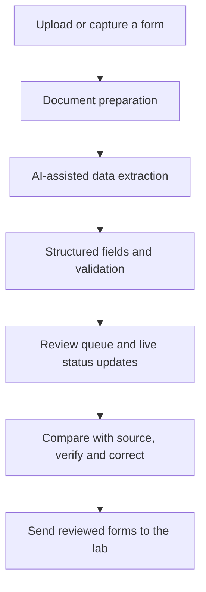

# AI-Powered Laboratory Form Processing

**From handwritten laboratory forms to structured, review-ready data.**

A full-stack application that streamlines the processing of laboratory commitment forms. It combines AI-assisted extraction, validation, human review, and live processing updates in a single web interface—reducing manual transcription and making difficult-to-read information easier to verify.

## Project Links

| Resource | Link |
| --- | --- |
| Live application | [Open the application](https://sheba-f05x.onrender.com) *(demo instance; the first load can take about a minute)* |
| Demo video | [Watch the demo (53 seconds)](docs/demo-video.mp4) |
| Source code | [GitHub repository](https://github.com/SaraKatz-T/Sheba_Project) |

## The Challenge

Laboratory forms often mix handwriting, printed text, stickers, and inconsistent layouts. Extracting and checking their contents manually is time-consuming, especially when values are unclear or appear in different locations across forms.

## Key Features

- **AI-powered extraction:** Identifies relevant information in complex documents and converts it into structured fields using Google Gemini.
- **Double-read patient names:** Each name is read twice—on the full page and in an enlarged crop—and the two readings are compared. Matching or near-matching readings are accepted; conflicting readings are flagged for review.
- **Flexible document intake:** Supports uploading documents and a QR-based workflow for capturing images from a phone.
- **Validation and review:** Highlights fields that need attention and allows users to verify and correct extracted values, with a history of every change.
- **Source-aware verification:** Displays the original form beside the extracted data, with contextual zoom into the field being reviewed.
- **Live processing dashboard:** Shows document status, queue progress, and real-time updates via WebSockets.
- **Send to lab:** Selected forms are exported to a password-protected Excel file and sent to the laboratory.
- **Trash and restore:** Deleted forms stay in a trash for 30 days and can be restored one by one or as a whole file.
- **Encryption at rest:** Personal data in the database and all stored images are encrypted.

## How It Works



## Tech Stack

| Layer | Technologies |
| --- | --- |
| Frontend | React, TypeScript, Vite, React Router, TanStack Query |
| Backend | Python, FastAPI, Uvicorn |
| AI & document processing | Google Gemini, Pillow, Tesseract, pypdfium2 |
| Real-time communication | WebSockets |
| Storage | SQLite and local file storage, encrypted with AES-256-GCM |
| Export | Excel (password-protected), email delivery via Resend |
| Deployment | Docker, Render |

## Security

- **Encryption at rest:** stored images and the personal-data columns of the database are encrypted with AES-256-GCM. Each file has its own key, and all keys are wrapped by a master key (`DATA_KEY`) that is kept outside the data. Keys of deleted files are removed, so leftovers on disk cannot be decrypted.
- **Exported files:** the Excel file sent to the lab is protected with a password that is shared separately, never in the email.
- **Web security:** login with a password and an HttpOnly session cookie, login rate limiting, HTTPS-only in the cloud, and a strict Content Security Policy.

## Project Structure

```text
Sheba_Project/
├── client/                    # React frontend, API client, UI and mock mode
│   └── docs/                  # API contract between the client and the server
├── server/
│   ├── server/                # FastAPI, processing queue, storage, encryption and live updates
│   ├── commitment_extractor/  # AI extraction pipeline
│   ├── prompts/               # Extraction prompts
│   ├── schemas/               # Structured output schemas for the model
│   ├── run_server.py          # Starts the API
│   ├── run_encrypt_setup.py   # One-time encryption setup and key rotation
│   └── requirements.txt
├── start_all.bat              # Local Windows launcher
└── Dockerfile                 # Single image: builds the client and serves it with the API
```

## Getting Started

### Frontend demo (without AI credentials)

```bash
cd client
npm install
```

Create `client/.env`:

```env
VITE_USE_MOCK=true
```

Then run:

```bash
npm run dev
```

Open [http://localhost:5173](http://localhost:5173). The mock login password is `demo`.

### Full application

Requirements: Python 3.14, Node.js 22 or later, and optionally [Tesseract](https://github.com/tesseract-ocr/tesseract) for straightening rotated pages.

1. In `server/`, create a virtual environment and install `requirements.txt`.
2. Create `server/.env` with at least:
   ```env
   APP_PASSWORD=choose-a-password
   GEMINI_API_KEY1=your-gemini-api-key
   COOKIE_SECURE=false
   ```
   For sending to the lab, also add `RESEND_API_KEY` and `EXPORT_EMAIL_TO`.
3. Run `python run_encrypt_setup.py` once from `server/`. It creates the encryption master key (`DATA_KEY`) and the Excel password in `server/.env`. Keep a copy of `DATA_KEY` in a safe place—without it the stored data cannot be read.
4. Start the API with `python run_server.py` from `server/`.
5. In `client/.env`, set `VITE_USE_MOCK=false` and `VITE_API_URL=http://localhost:8000`, then run `npm run dev` in `client/`.

On Windows, `start_all.bat` starts both services once the local environments are configured.

## Data Privacy

Use synthetic or de-identified documents in public demos. Keep API credentials, `.env` files, patient data, uploaded documents, local databases, and generated files out of the public repository. Real patient data should only be processed with a paid Gemini plan: on the free tier, Google may use submitted content to improve its products.
